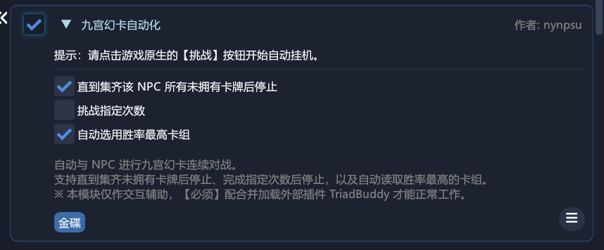
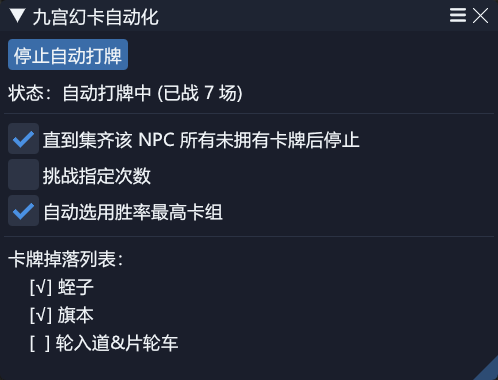
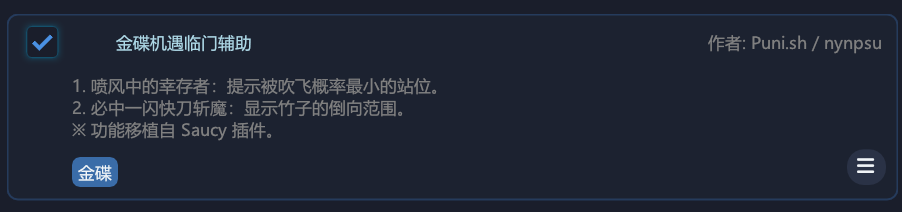
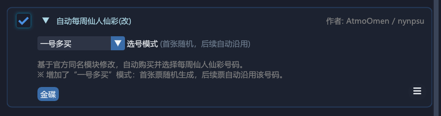
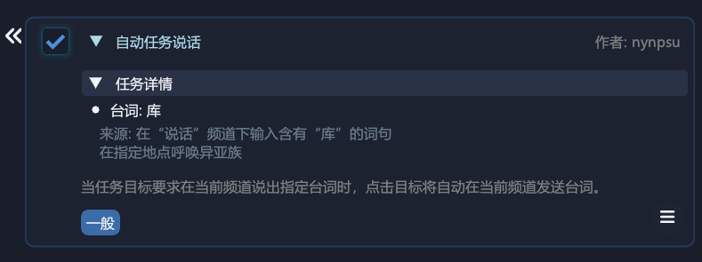
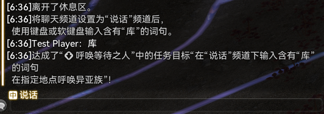
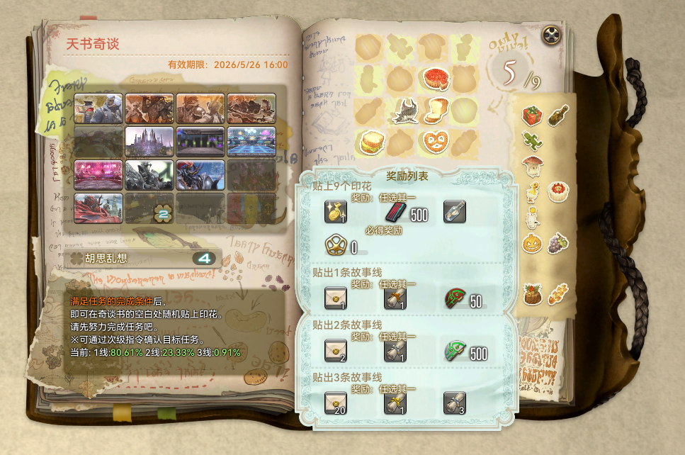
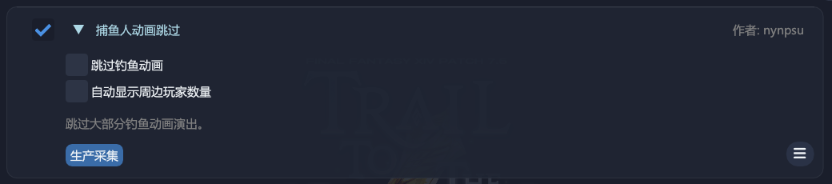
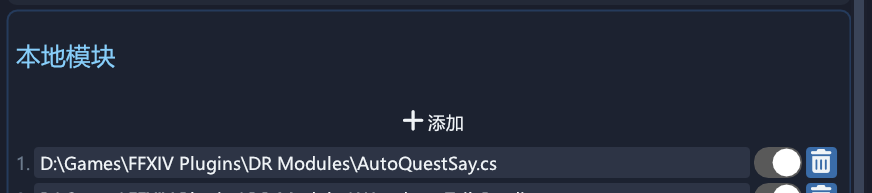

# 🛠️ DailyRoutines Local Modules

> 个人自用的 DailyRoutines (DR) 本地增强与定制化模块备份。

---

## 🎰 金碟游乐场 (Gold Saucer)

### 1. 九宫幻卡自动化 (`AutoTripleTriad.cs`)
自动与 NPC 进行九宫幻卡连续对战，加速卡牌收集。
- **对战目标**：支持完成指定对战次数后停止，或集齐该 NPC 所有未拥有卡牌后自动停止。
- **卡组选择**：支持自动读取并选用当前胜率最高的推荐卡组，或手动指定卡组槽位。
- **掉落追踪**：对战期间在配置界面实时展示当前 NPC 的可掉落卡牌与收集状态。

> [!WARNING]
> 本模块仅负责交互与流程控制，必须配合并开启外部插件 **TriadBuddy** 才能正常工作。

  
  &nbsp;&nbsp;&nbsp;&nbsp;
  

---

### 2. 金碟机遇临门辅助 (`GoldSaucerGATEsHelper.cs`)
金碟游乐场机遇临门（GATE）辅助，部分功能移植自 Saucy。
- **喷风中的幸存者**：标示被吹飞概率最低的安全站位，并通过颜色实时区分是否已就位。
- **必中一闪快刀斩魔**：根据竹子劈砍类型（单刀、双刀、圆形），提前绘制对应的攻击范围。
- **空军装甲驾驶员**：自动锁定并射击正分目标，避开扣分炸弹。

  

  
  &nbsp;&nbsp;
  

---

### 3. 自动每周仙人仙彩(改) (`AutoJumboCactpotCustom.cs`)
进入仙人仙彩界面后，自动购买本周所有的仙人彩。
- **一号多买**：首张彩票随机生成号码，15 秒内购买的后续彩票自动沿用该号码。

  

---

## 📅 日常与周常 (Daily & Weekly)

### 4. 自动雇员作业(改) (`AutoRetainerWorkCustom.cs`)
自动完成雇员相关操作，支持批量出售改价、确认探险结果、均分或取回金币和修改登记城镇。
- **跳过对话**：与雇员交互期间自动联动开启“自动跳过对话”模块，交互结束后自动关闭。
- **低价保护**：自动改价时若最低价相比次低价跌幅达到阈值，自动跳过该异常低价并顺延参考后续价格。

  

---

### 5. 自动任务说话 (`AutoQuestSay.cs`)
自动处理任务交互中要求在当前频道说出指定台词的环节。
- **自动发言**：点击任务目标时自动在 `/say` 频道发送任务要求的台词。
- **多语解析**：直接从本地任务文本表中提取匹配台词，支持中、日、英、德、法客户端。

  
  &nbsp;&nbsp;&nbsp;&nbsp;
  

---

### 6. 天书连线概率 (`WondrousTailsPredictor.cs`)
在库洛的奇谈书界面实时计算并显示连线概率，辅助洗牌决策。
- **概率计算**：根据当前已贴印章分布，精确计算达成 1 / 2 / 3 条连线的概率。
- **多色提示**：按概率阈值通过不同颜色高亮显示（满概率、高概率、零概率），直观辅助洗牌判断。

  

  

---

## 🎣 生产与采集 (Craft & Gather)

### 7. 捕鱼人动画跳过 (`FisherAnimationSkipper.cs`)
跳过大部分钓鱼动画演出，提升采集体验。
- **动作过滤**：跳过抛竿、提竿与收杆等动作动画，保留基础待机与咬钩提示。
- **职业联动**：切换至捕鱼人时自动显示悬浮开关（含周边玩家数量显示联动），切出其他职业时自动关闭并还原。

  

---

## 🎨 界面示例

在 DailyRoutines 中加载后的本地模块列表界面展示：

  

