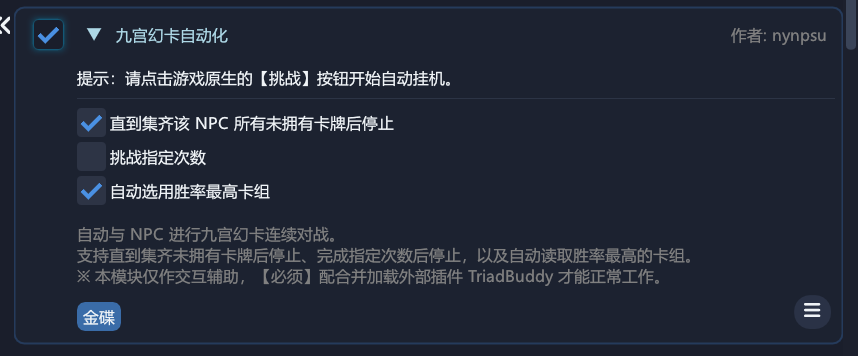
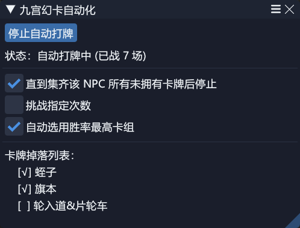
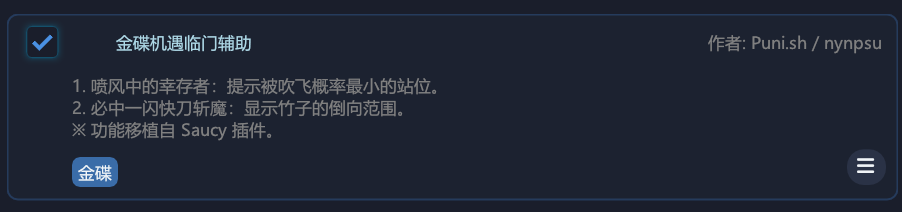
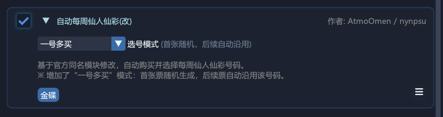
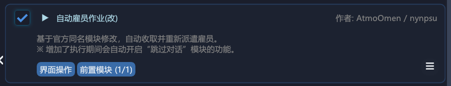
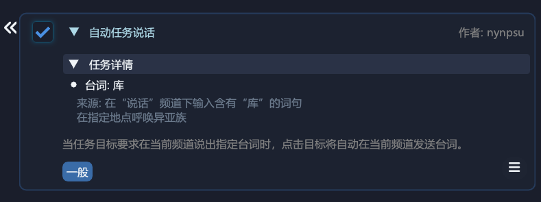
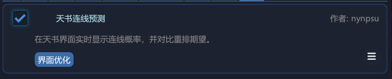
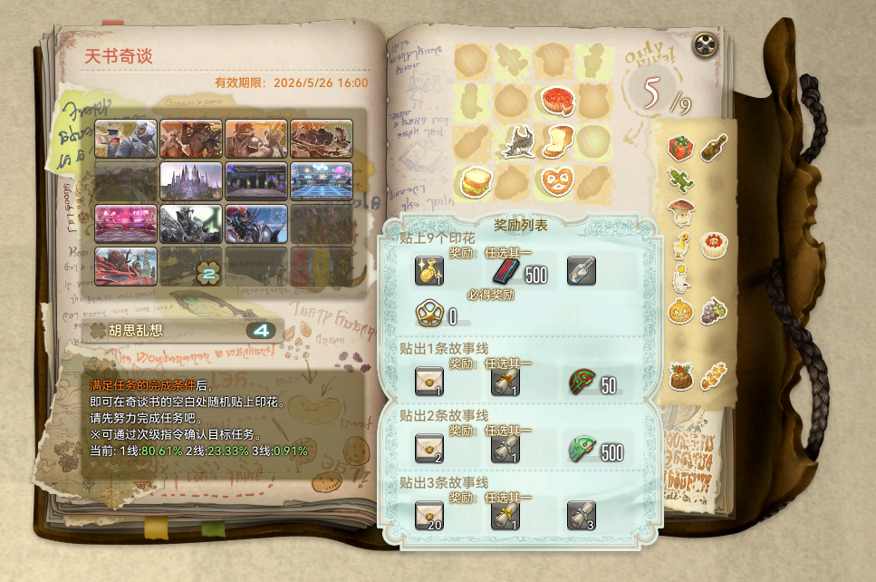
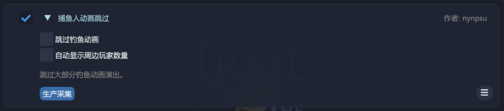
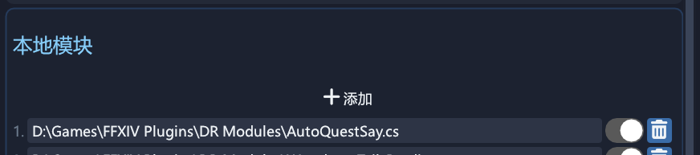

# 🛠️ DailyRoutines Local Modules

> 个人自用的 DailyRoutines (DR) 本地增强与定制化模块备份。

---

## 🎰 金碟游乐场 (Gold Saucer)

### 1. 九宫幻卡自动化 (`AutoTripleTriad.cs`)
自动与 NPC 进行九宫幻卡对战，加速卡牌收集。
- **对战目标**：支持对战指定次数，或直到收集齐该 NPC 的所有幻卡。
- **自动配卡**：自动读取并应用当前胜率最高的卡组。

> [!WARNING]
> 本模块仅作交互辅助，必须配合并开启外部插件 **TriadBuddy** 才能正常工作。

  
  &nbsp;&nbsp;&nbsp;&nbsp;
  

---

### 2. 金碟机遇临门辅助 (`GoldSaucerGATEsHelper.cs`)
金碟游乐场随机活动（GATE）辅助，部分功能移植自 Saucy。
- **喷风中的幸存者**：标示推荐的最佳安全站位，并实时提示是否已就位。
- **必中一闪快刀斩魔**：高亮标示竹子倒向与攻击波及范围。
- **空军装甲驾驶员**：自动瞄准并射击目标，避开炸弹。

  

  
  &nbsp;&nbsp;
  

---

### 3. 自动每周仙人仙彩(改) (`AutoJumboCactpotCustom.cs`)
自动购买每周仙人仙彩，基于官方原版进行增强。
- **一号多买**：首张彩票随机号码，后续购买的彩票自动沿用该号码。

  

---

## 📅 日常与周常 (Daily & Weekly)

### 4. 自动雇员作业(改) (`AutoRetainerWorkCustom.cs`)
自动收取雇员探险、重新派遣并处理物品改价。
- **自动跳过对话**：收发雇员期间自动跳过 NPC 对话，过程更流畅。
- **超低物价保护**：自动改价时过滤个例断层超低价，防止因恶意压价或错价导致亏损。

  

---

### 5. 自动任务说话 (`AutoQuestSay.cs`)
自动处理任务交互中需要玩家发送特定频道消息（如 `/say` 任务台词）的环节。
- **自动发送台词**：点击任务目标时自动发送匹配的台词，支持多语言客户端。

  
  &nbsp;&nbsp;&nbsp;&nbsp;
  

---

### 6. 天书连线概率 (`WondrousTailsPredictor.cs`)
在库洛的奇谈书界面提供连线概率计算与洗牌决策辅助。
- **多色概率提示**：实时显示 1 / 2 / 3 线连线概率，并通过颜色高亮辅助洗牌判断。

  

  

---

## 🎣 生产与采集 (Craft & Gather)

### 7. 捕鱼人动画跳过 (`FisherAnimationSkipper.cs`)
跳过钓鱼动画演出，提升采集效率。
- **动作跳过**：自动跳过抛竿、提竿与起鱼动作，保留基础待机与咬钩提示。

  

---

## 🎨 界面示例

在 DailyRoutines 中加载后的本地模块列表界面展示：

  

